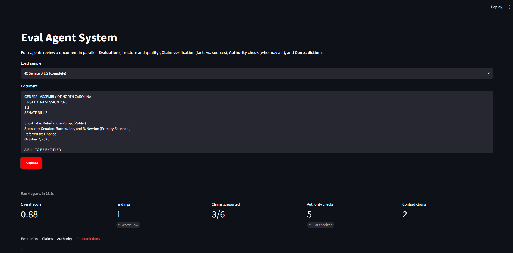
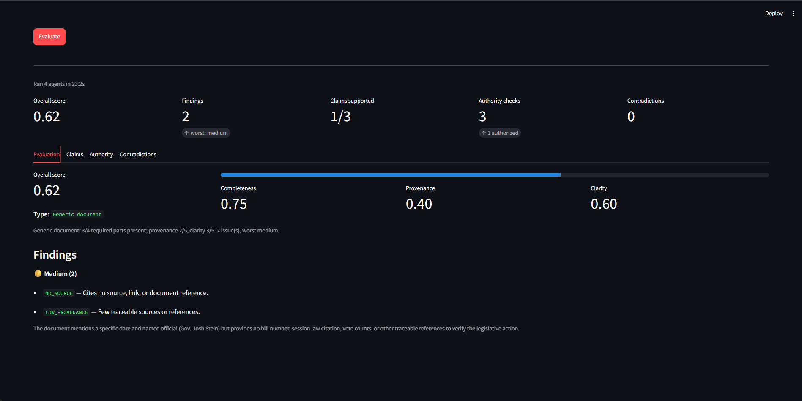
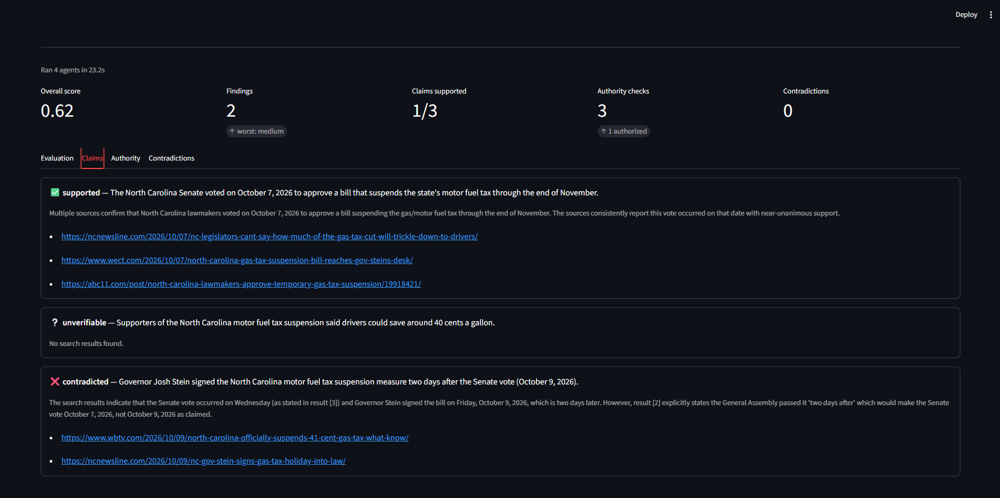
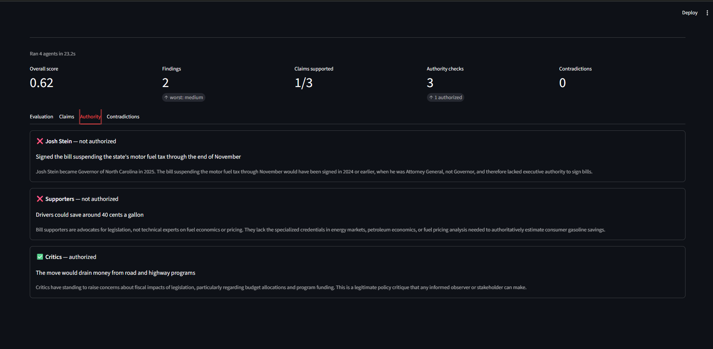

# Eval Agent System (LangGraph)

Four agents, each owned by one team member, wired together as a LangGraph.

```
src/eval_system/
  state.py                 shared state + each agent's output contract
  graph.py                 edges between agents (the only place wiring lives)
  agents/
    evaluation/            Evaluation Agent        -> state["evaluation"]
    claim_verification/    Verifying Claims Agent  -> state["claim_verification"]
    authority_check/       Legitimate Authority    -> state["authority_check"]
    contradiction/         Contradiction Agent     -> state["contradictions"]
      agent.py             node function + logic
      prompts.py           prompts for that agent
```

Flow: START -> 4 agents in parallel -> `aggregate` -> END.

## Screenshots
Overview: load a sample (here NC Senate Bill 2), run the four agents, and get one headline number per agent.



Results for the sample news article, one tab per agent:

| Evaluation | Claims |
|---|---|
|  |  |



## Run
```
python -m venv .venv && .venv\Scripts\activate
pip install -r requirements.txt
cd src && python -m eval_system path/to/doc.txt
```

## Working on an agent
Edit only your folder (`agent.py`, `prompts.py`). Keep the node signature
`def x_node(state: EvalState) -> dict` and return only your own state key. If your output
shape changes, update its type in `state.py` and tell the others. All agents are stubs
for now (marked `TODO`).

## LLM (Snowflake Cortex)
All agents call one function, `src/eval_system/llm.py::snowflake_llm` (or `snowflake_json`), which posts to
Snowflake's Cortex `inference:complete` REST endpoint using key-pair (JWT) auth, which needs no network policy.

One-time setup (from `src/`):
1. `python setup_snowflake.py` creates a key pair, saves the private key to `src/.streamlit/secrets.toml`
   (gitignored), and prints one `ALTER USER ... SET RSA_PUBLIC_KEY='...'` command.
2. Run that command in a Snowsight worksheet as ACCOUNTADMIN.
3. Test with `python -m eval_system.llm`.

Set `SNOWFLAKE_MODEL` in `secrets.toml` to change the model (default `mistral-large2`).

## Web app (Streamlit)
```
cd src && streamlit run app.py     # http://localhost:8501
```
`src/app.py` is the whole UI; it calls the LangGraph directly.

## Deploy (Streamlit Community Cloud)
1. Push this repo to GitHub.
2. On https://share.streamlit.io: New app > pick the repo, branch `main`, main file `src/app.py`.
3. Paste the contents of your local `src/.streamlit/secrets.toml` into the app's Secrets settings. Never commit it.
